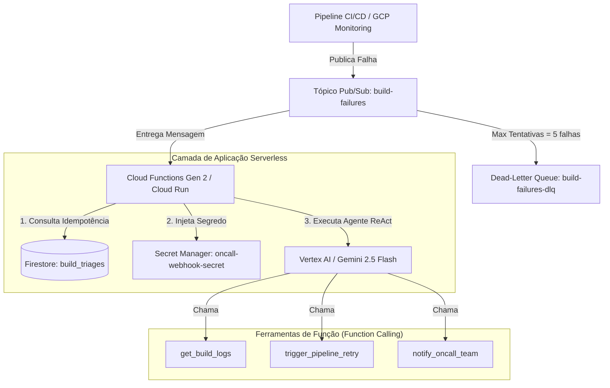
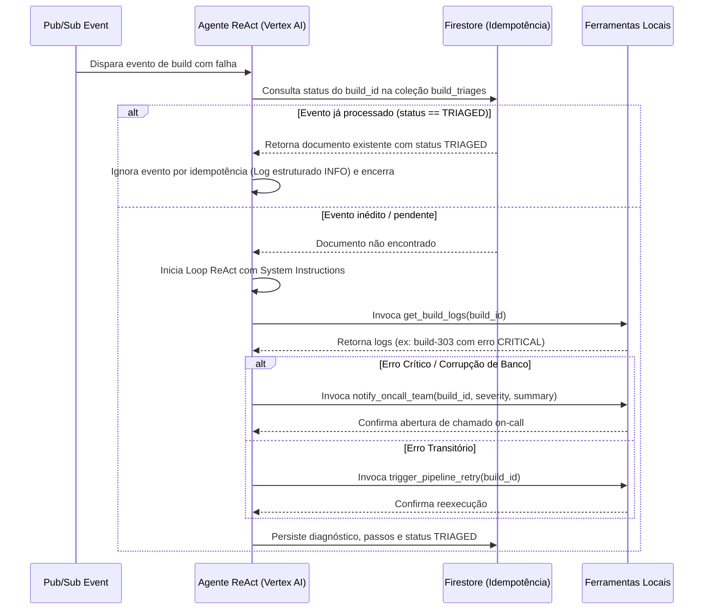

# Relatório Técnico — Exame Especial: Plataforma Serverless de Triagem Inteligente de Incidentes DevOps

**Aluno(a):** Angelo Máximo Moreira Silva  
**Disciplina:** Serverless Computing e Arquiteturas Event-Driven  
**Repositório:** `pucminas-exameespecial`

---

## 1. Visão Geral e Objetivos

Este relatório técnico documenta a implementação e evolução da **Plataforma Serverless de Triagem Inteligente de Incidentes DevOps**, uma solução orientada a eventos no Google Cloud para triagem automatizada de falhas em pipelines de CI/CD utilizando Inteligência Artificial Generativa (Vertex AI / Gemini). O projeto integra os seguintes pilares arquiteturais:

1. **Arquitetura Event-Driven, Idempotência e Resiliência (DLQ)**.
2. **Agentes Autônomos com Vertex AI, Function Calling e Loop ReAct**.
3. **Segurança Avançada (IAM de Menor Privilégio + Secret Manager) e CI/CD (Cloud Build)**.
4. **Observabilidade (Logs Estruturados em JSON), Mitigação de Cold Start e Limitação de Custos**.

---

## 2. Arquitetura da Solução e Fluxos

### 2.1. Diagrama Geral da Arquitetura (Mermaid)



### 2.2. Fluxo do Agente ReAct e Function Calling



---

## 3. Explicações Técnicas por Etapa

### Etapa 1 — Arquitetura Event-Driven, Idempotência e DLQ

* **Resiliência com Dead-Letter Queue (DLQ):**  
  Para evitar loops infinitos de reprocessamento causados por mensagens malformadas ou falhas sistêmicas no Pub/Sub, configurou-se uma política de redirecionamento (`dead_letter_policy`) no tópico principal `build-failures` apontando para o tópico `build-failures-dlq`, com limite de `max_delivery_attempts = 5`.
* **Controle de Idempotência no Consumidor (`src/main.py`):**  
  Garante que a entrega Pub/Sub ("pelo menos uma vez") não resulte em duplicidade de processamento. Antes de invocar o modelo Vertex AI, o sistema consulta a coleção `build_triages` no Firestore. Se o build já constar como `TRIAGED`, o evento é descartado de forma idempotente com log estruturado.

### Etapa 2 — Evolução do Agente de IA com Function Calling e Loop ReAct

* **Nova Ferramenta (`notify_oncall_team`):**  
  Integração da terceira ferramenta declarada via `FunctionDeclaration` (`notify_oncall_team`), recebendo `build_id`, `severity` e `error_summary` para gerenciar o escalonamento de incidentes críticos.
* **Cenário Crítico (`build-303`):**  
  Simulação na função `local_get_build_logs` de um log de corrupção de banco de dados (`CRITICAL: Database corruption detected in production cluster...`), orientando o agente via `system_instruction` a acionar o time de plantão autonomamente.

### Etapa 3 — Segurança (IAM + Secret Manager) e Pipeline CI/CD

* **Princípio de Menor Privilégio e Secret Manager:**  
  A Service Account `triage-agent-event-sa` possui apenas as permissões estritamente necessárias (`roles/aiplatform.user`, `roles/datastore.user` e `roles/secretmanager.secretAccessor`). O segredo `oncall-webhook-secret` é injetado de forma segura em tempo de execução via `secret_environment_variables` no `service_config`.
* **Esteira CI/CD (`cloudbuild.yaml`):**  
  Automação validando dependências, executando a suíte de testes unitários com mocks (`unittest`) e verificando a formatação/sintaxe do Terraform (`terraform fmt -check` e `terraform validate`).

---

## 4. Detalhamento da Etapa 4 — Observabilidade, Otimização de Cold Start e Limitação de Custos

### 4.1. Observabilidade com Logs Estruturados (`src/main.py`)

Para garantir rastreabilidade eficiente no **Google Cloud Logging**, foi implementada a função auxiliar `log_structured(severity, message, build_id=None, **kwargs)`.

* **Formato Padronizado:** Emite registros em JSON válido de linha única (`json.dumps(payload, ensure_ascii=False)`).
* **Rastreamento de Contexto:** Todos os eventos críticos (recebimento da mensagem, descarte por idempotência, invocação de ferramentas no loop ReAct e encerramento da triagem) incluem o identificador `build_id` e a severidade adequada (`INFO`, `WARNING`, `ERROR`), permitindo filtragem direta nos painéis de observabilidade.

### 4.2. Práticas de Otimização de Cold Start e Controle de Custos (`main.tf` e `src/main.py`)

Para equilibrar baixa latência na resposta a incidentes críticos e previsibilidade financeira em ambientes serverless, foram aplicadas as seguintes práticas:

1. **Instâncias Mínimas Aquecidas (`min_instance_count = 1` no `main.tf`):** Mantém pelo menos 1 instância do container em execução ociosa pronta para receber requisições imediatamente, eliminando o tempo de inicialização do ambiente Python e das bibliotecas de IA.
2. **Teto Rígido de Escalabilidade (`max_instance_count = 3` no `main.tf`):** Impede escalonamentos descontrolados em cenários de picos inesperados, limitando custos operacionais.
3. **Dimensionamento Otimizado de Recursos (`available_memory = "512Mi"`):** Aloca memória suficiente para comportar o runtime Python 3.12 e SDKs do GCP sem incorrer nos custos elevados de instâncias superdimensionadas.
4. **Inicialização Global e Reuso de Conexões — Warm Starts (`src/main.py`):** Clientes do Firestore e inicializações da Vertex AI posicionados fora do handler principal, reaproveitando conexões TCP/gRPC entre invocações consecutivas.

---

## 5. Evidência e Análise da Execução dos Testes Unitários

A suíte de testes unitários foi desenvolvida no arquivo `test_main.py` utilizando o framework padrão `unittest` em conjunto com `unittest.mock`. O objetivo principal foi validar de forma isolada, rápida e sem custos de nuvem os seguintes comportamentos críticos da aplicação:

1. O retorno adequado das funções locais de ferramentas (`local_get_build_logs`, `local_trigger_pipeline_retry` e `local_notify_oncall_team`).
2. A simulação correta do cenário de erro crítico (`build-303`).
3. O comportamento de curto-circuito da idempotência quando o Firestore retorna que um `build_id` já foi processado com status `TRIAGED`.

### Saída Oficial da Execução dos Testes

Abaixo encontra-se o log completo capturado durante a execução da suíte de testes unitários no terminal:

```bash
$ python3 -m unittest test_main.py -v
test_get_build_logs_critical_303 (__main__.TestDevOpsAgent) ... ok
test_get_build_logs_normal (__main__.TestDevOpsAgent) ... ok
test_idempotency_skip (__main__.TestDevOpsAgent) ... ok
test_notify_oncall_team (__main__.TestDevOpsAgent) ... ok
test_trigger_pipeline_retry (__main__.TestDevOpsAgent) ... ok

----------------------------------------------------------------------
Ran 5 tests in 0.008s

OK
```

## Observação  
Para rodar os testes com mock, as informações referentes ao ID do projeto no GCP foram inseridas como variáveis de ambiente no terminal:  

`export GCP_PROJECT="meu-projeto-real-gcp`  
`export GCP_REGION="us-central1"`  

### Análise dos Resultados

* **`test_get_build_logs_normal`:** Validou com sucesso a recuperação de logs para builds padrão (como o `build-101`), garantindo que o agente obtenha o payload correto de erro de infraestrutura.
* **`test_get_build_logs_critical_303`:** Validou com sucesso o novo cenário exigido na Etapa 2 (`build-303`), confirmando que a string retornada contém o marcador `CRITICAL` e a descrição de corrupção de dados.
* **`test_trigger_pipeline_retry`:** Validou o acionamento bem-sucedido da reexecução de pipeline para erros transitórios.
* **`test_notify_oncall_team`:** Validou a execução correta da nova ferramenta de notificação on-call, assegurando o repasse adequado dos parâmetros de severidade e resumo de erro.
* **`test_idempotency_skip`:** Utilizou `unittest.mock` para simular uma resposta positiva do Firestore (`doc.exists = True` e `status == "TRIAGED"`), comprovando que o mecanismo de idempotência cumpre seu papel de evitar reprocessamentos desnecessários.

---

## 6. Mapeamento dos Arquivos do Projeto (`exame-especial/`)

| Arquivo | Descrição da Responsabilidade |
| :--- | :--- |
| `terraform/main.tf` | Infraestrutura como Código (Pub/Sub, DLQ, Secret Manager, Cloud Functions Gen 2, IAM e Cold Start). |
| `src/main.py` | Lógica principal do agente ReAct, Function Calling, Firestore, Idempotência, Warm Start e Logs JSON. |
| `src/requirements.txt` | Dependências Python (`vertexai`, `google-cloud-firestore`, `functions-framework`, etc.). |
| `test_main.py` | Suíte de testes unitários com `unittest` e mocks para cobrir idempotência e funções locais. |
| `cloudbuild.yaml` | Definição da esteira CI/CD (Testes + Validação Terraform). |
| `.gitignore` | Regras de segurança para exclusão de credenciais, estados e arquivos temporários. |
| `RELATORIO_EXAME.md` | Documentação técnica detalhada, diagramas Mermaid, práticas de Cold Start e evidências de testes. |